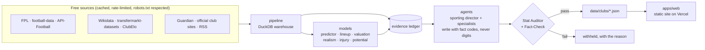

# dugout

An open-source AI sporting director for the Premier League. Free data, open-weight models, and one hard rule:
**the LLM never writes a number.** Every figure is filled from an evidence ledger, re-run by a Stat Auditor and
checked against independent sources by Fact-Check before anything is published. On the website, every number opens
a card with its source, fetch time and verification status.

[](docs/agents.md)
[](https://github.com/delta96040/dugout/actions/workflows/ci.yml)
[](https://github.com/delta96040/dugout/actions/workflows/nightly.yml)
[](LICENSE)

**Live site:** _link added after the first deploy_ · **How it works:** [docs/agents.md](docs/agents.md) ·
**Model evidence:** [docs/backtests](docs/backtests/README.md)

## What it does

For each club it writes a scouting dossier: how the side plays and where it sits, the next match prediction, the
likely XI, verified news, the squad's biggest gap and a shortlist to fill it, with fees, playing-time outlook and
how realistic each move is. A scroll story on the home page walks through the showcase club; the scoreboard shows
every prediction next to the real result, right or wrong.



A GitHub Actions job runs every night: ingest, refit and publish the models, rebuild every dossier, re-run both
verifiers and the site's own digit check, then commit the JSON. Vercel deploys each data commit.

## Quick start

See the site with the committed data (no keys needed):

```bash
git clone https://github.com/delta96040/dugout && cd dugout
npm --prefix apps/web ci
npm --prefix apps/web run dev        # http://localhost:3000
```

Run the pipeline yourself (Python 3.12, [uv](https://docs.astral.sh/uv/)); every API key is free:

```bash
cp .env.example .env                 # add your keys
uv sync && uv run dugout ingest      # then: uv run dugout status
uv run dugout-models publish && uv run dugout-agents --no-llm dossier liverpool
```

`make` targets mirror these for macOS/Linux. Point it at your club with `uv run dugout setup-club <club>`.

## Honest limitations

- **Bookmakers are still better** than the match predictor. It beats Elo on every scoring rule in both test seasons
  ([report](docs/backtests/predictor.md)); closing odds win.
- **The LLM is small and free.** Drafts that fail a check are replaced by deterministic templates; most club
  dossiers are template-written. The free tier's daily quota covers the showcase clubs only.
- **Some models are weak and say so**: injury risk is shown as tiers, style similarity does not predict minutes,
  and FootballBERT was not adopted because its apparent signal was leakage ([all backtests](docs/backtests/README.md)).
- **Free data has gaps**: API-Football's free plan covers a rolling window, confirmed lineups arrive shortly before
  kick-off, and Transfermarkt values are refreshed by hand (never scraped from CI).
- **Premier League only** for now. Leagues are config (`config/leagues.yaml`), not code.

## Contributing

Issues and pull requests are welcome; see [CONTRIBUTING.md](CONTRIBUTING.md). Good first issues are labelled.

## Data credits

StatsBomb Open Data · Wyscout public dataset (Pappalardo et al., 2019, *Scientific Data* 6:236) · SkillCorner Open Data ·
Metrica Sports sample data · PFF FC World Cup 2022 · Reep Register (CC0) · transfermarkt-datasets (CC0) ·
football-data.co.uk · football-data.org · API-Football · Fantasy Premier League · ClubElo · Open-Meteo (CC-BY 4.0) ·
Wikidata (CC0) · postcodes.io (OGL) · The Guardian Open Platform · official club websites (press credited to the
original outlet). Every source and its terms: [docs/sources.md](docs/sources.md).

## Licence

MIT. Data stays under its providers' terms; raw scraped data is never committed or redistributed.
